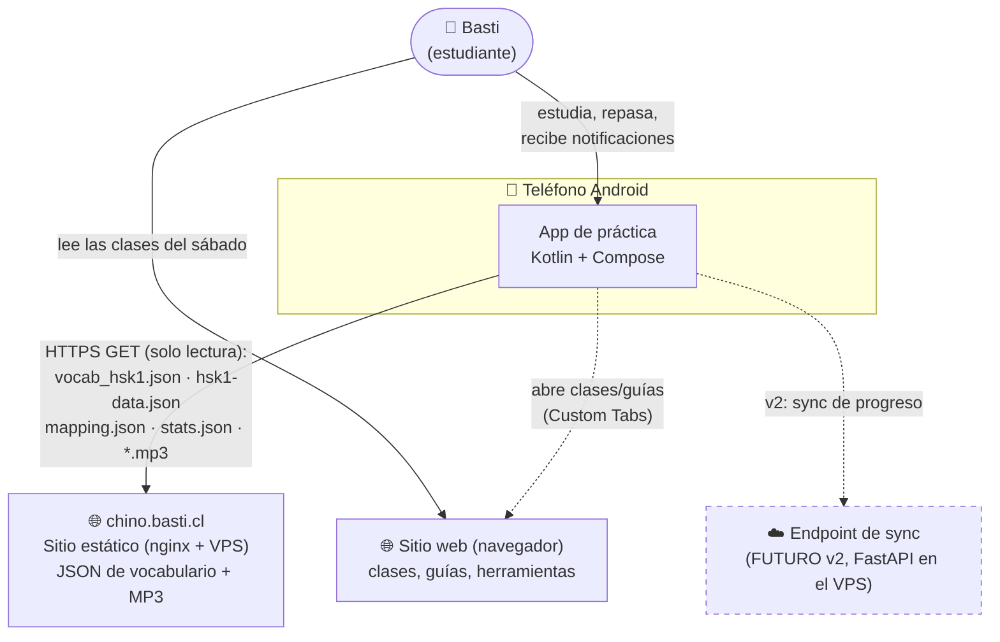
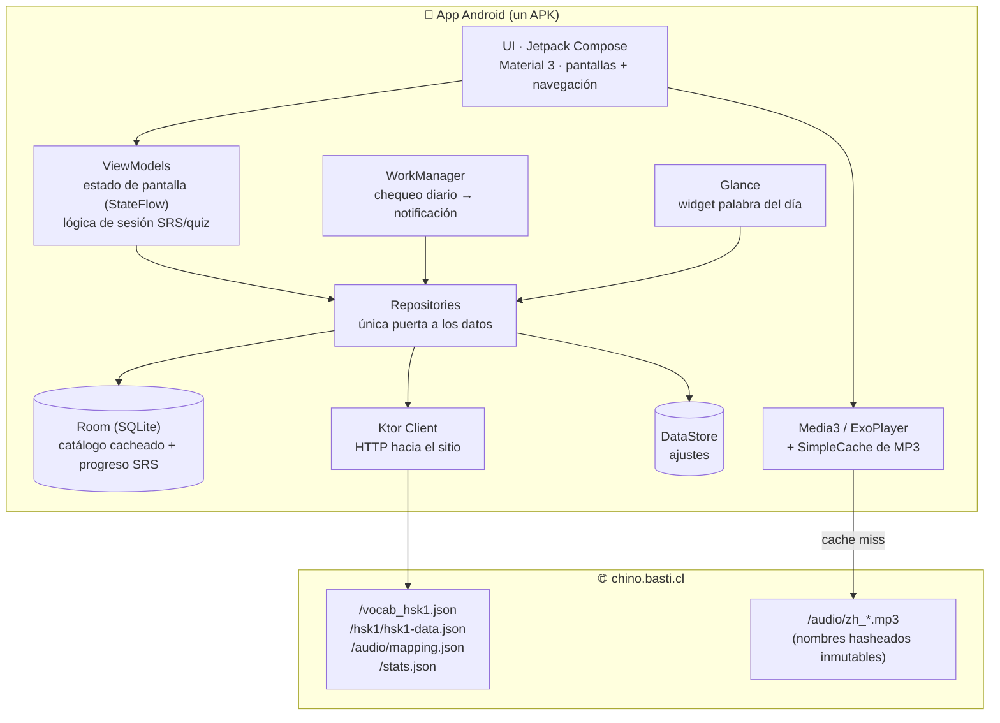
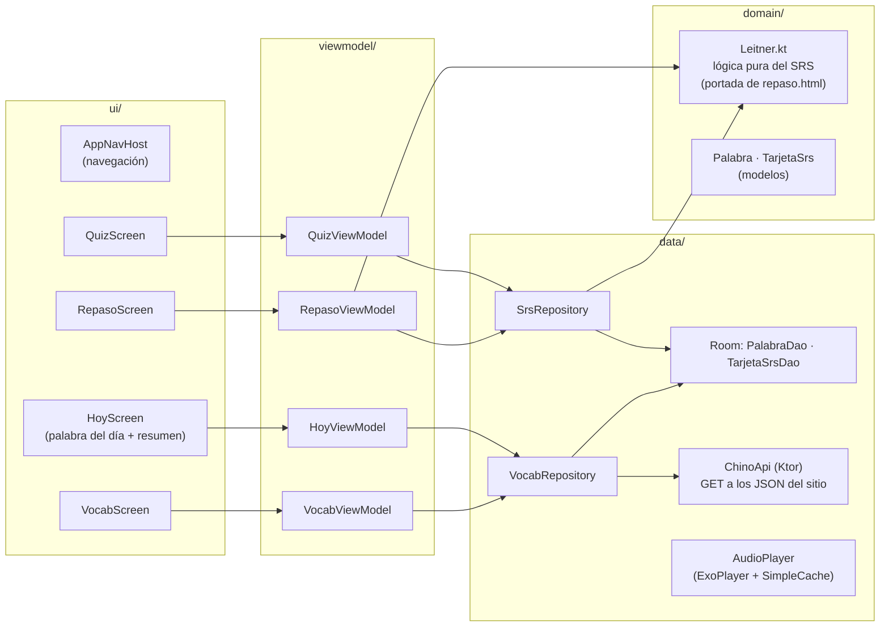

# 01 — Arquitectura del sistema (C4)

> App de práctica de chino · Kotlin + Jetpack Compose · [Volver al índice](INDEX.md)
> Fuente de decisiones: [APP-MOVIL.md](../../APP-MOVIL.md) y [07-decisiones-adr.md](07-decisiones-adr.md)

## Nivel 1 — Contexto

Quién usa el sistema y con qué habla. La clave: **no hay backend nuevo** — el
sitio estático existente ES el proveedor de datos (solo lectura).

## Nivel 2 — Contenedores

Dentro del teléfono. La app es un solo contenedor Android; el "backend" son
archivos estáticos servidos por nginx.

**Reglas de dependencia (las flechas solo apuntan hacia adentro/abajo):**
- La UI no conoce Room ni Ktor; solo observa ViewModels.
- Los ViewModels no saben si un dato vino de la red o del disco; solo llaman al Repository.
- El Repository es el único que decide *de dónde* sale cada dato (política cache-first).
- WorkManager y Glance entran por el Repository igual que la UI — sin atajos.

## Nivel 3 — Componentes del contenedor app

Organización en paquetes Kotlin (módulo único en v1; la separación en módulos
`data`/`domain` queda para cuando se explore Kotlin Multiplatform).

**Nota pedagógica:** `domain/Leitner.kt` es Kotlin puro (sin imports de Android).
Eso lo hace testeable con JUnit a secas y portable a KMP el día de iOS.

## El contrato de datos (la "API")

| Recurso | Método | Qué trae | Usado por |
|---|---|---|---|
| `/vocab_hsk1.json` | GET | 300 palabras `{hz, py, es, cat, banda, audio}` | catálogo principal |
| `/hsk1/hsk1-data.json` | GET | 150 del sílabo `{hz, py, es, tema, clases[]}` | temas + trazabilidad |
| `/audio/mapping.json` | GET | `texto → archivo.mp3` | resolver audio de frases |
| `/stats.json` | GET | agregados (última clase, conteos) | pantalla Hoy |
| `/audio/zh_*.mp3` | GET | audio (inmutable por nombre) | ExoPlayer, cache-first |

⚠️ Estos archivos son un **contrato**: renombrar un campo rompe la app.
Están documentados en [`chino/DATA.md`](../../chino/DATA.md) y validados por CI.
