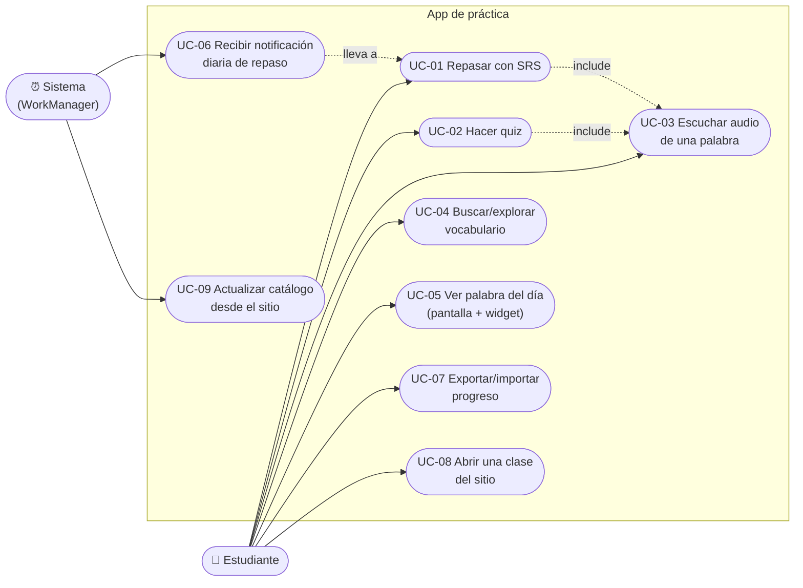

# 02 — Casos de uso

> App de práctica de chino · [Volver al índice](INDEX.md)
> Actores: **Estudiante** (Basti) y **Sistema** (WorkManager, sin intervención humana).

## Diagrama general

## Detalle de los casos core

### UC-01 · Repasar con SRS (el corazón de la app)
| | |
|---|---|
| **Actor** | Estudiante |
| **Precondición** | Catálogo en Room; puede estar sin conexión |
| **Flujo principal** | 1. Abre "Repaso" → el sistema arma la cola: vencidas (`due <= ahora`) + hasta N nuevas. 2. Muestra tarjeta (hanzi grande). 3. Estudiante piensa y destapa (pinyin + español + 🔊). 4. Marca "la sabía" / "no la sabía". 5. El sistema aplica Leitner: correcta → sube de caja (1→2→3→4→5), incorrecta → vuelve a caja 1; recalcula `due` (intervalos 0/1/3/7/21 días). 6. Repite hasta vaciar la cola. 7. Resumen de la sesión. |
| **Alternativos** | 3a. Sin audio cacheado y sin red → botón 🔊 deshabilitado con aviso. 1a. Cola vacía → mensaje "🎉 nada pendiente" + acceso a quiz. |
| **Postcondición** | Cajas y fechas `due` actualizadas en Room |
| **Origen** | Port de `chino/hsk1/repaso.html` (misma lógica, mismos intervalos) |

### UC-02 · Hacer quiz
| | |
|---|---|
| **Actor** | Estudiante |
| **Flujo principal** | 1. Elige modo: hz→es, es→hz o audio→hz `[INFERRED: mismos 3 modos que quiz.html]`. 2. El sistema genera pregunta + 3 distractores de la misma categoría. 3. Responde; feedback inmediato con audio. 4. Al fallar, la palabra se **inyecta al SRS en caja 1** (integración clave que la web no tiene entre herramientas). 5. Racha y puntaje al final. |
| **Postcondición** | Fallos registrados en el SRS |

### UC-06 · Recibir notificación diaria (Sistema)
| | |
|---|---|
| **Actor** | WorkManager (programado ~09:00, configurable) |
| **Flujo principal** | 1. Se despierta el worker. 2. Consulta a Room el conteo de vencidas. 3. Si > 0 → notificación local "Tienes N palabras por repasar 加油!". 4. Tap → abre directo UC-01. |
| **Alternativos** | 2a. Conteo 0 → no molesta (regla: nunca notificar por notificar). |
| **Nota** | 100% local: no requiere red ni servidor de push. |

### UC-09 · Actualizar catálogo (Sistema)
| | |
|---|---|
| **Trigger** | Al abrir la app con red (throttle: máx. 1 vez/día) `[INFERRED]` |
| **Flujo principal** | 1. GET a los JSON del sitio. 2. Upsert en Room (nuevas palabras entran como "nuevas" para el SRS). 3. La UI se actualiza sola (observa Flows de Room). |
| **Alternativos** | 1a. Sin red o error HTTP → la app sigue con la copia local, sin errores visibles. |
| **Regla** | El refresh **jamás toca el progreso** (cajas/due), solo el catálogo. |

## Casos v2 (fuera del alcance v1)
- **UC-07 sync automático** contra endpoint en el VPS (v1 solo export/import manual de JSON, mismo formato que la web — ver PLAN-MEJORAS 5.4).
- Drill de tonos y quiz de trazos (si se hacen, siguen el patrón de UC-02).
