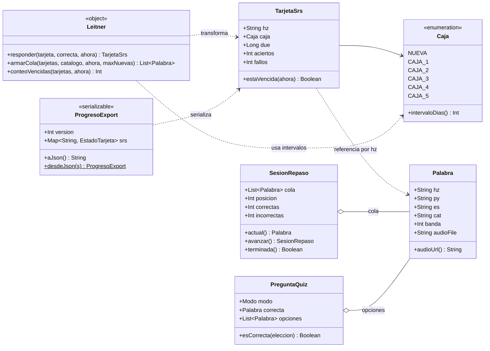

# 03 — Modelo de dominio (clases)

> App de práctica de chino · [Volver al índice](INDEX.md)
> Todo lo de este archivo es **Kotlin puro sin Android** (paquete `domain/`):
> testeable con JUnit y portable a Kotlin Multiplatform.

## Diagrama de clases

Ejemplos de valores: `Palabra("爱", "ài", "amar, querer", "verbos", 150, "zh_8f743c2c68.mp3")` ·
`TarjetaSrs("爱", CAJA_3, due=epoch millis)` · `Modo` = HZ_ES / ES_HZ / AUDIO_HZ.
El detalle campo a campo (tipos SQL, nullabilidad) está en [04-er-room.md](04-er-room.md).

## Las reglas de negocio (el "por qué" de cada clase)

### Leitner — la única lógica con derecho a mover cajas

Port directo de `chino/hsk1/repaso.html`:

| Evento                        | Regla                                                                 |
| ----------------------------- | --------------------------------------------------------------------- |
| Respuesta**correcta**   | sube una caja (tope: CAJA_5)                                          |
| Respuesta**incorrecta** | vuelve a CAJA_1, siempre                                              |
| Nuevo`due`                  | `ahora + intervaloDias(cajaNueva)`                                  |
| Intervalos                    | NUEVA→0 · C1→0 · C2→1 · C3→3 · C4→7 · C5→21 días          |
| Cola de sesión               | vencidas (`due <= ahora`) primero + hasta `maxNuevas` sin tarjeta |

Diseño clave: `Leitner.responder()` **devuelve una tarjeta nueva** (inmutable),
no muta la existente. Facilita tests (`assertEquals`) y evita estados a medias.

### TarjetaSrs vs Palabra — separación deliberada

- `Palabra` = **catálogo**: viene del sitio, se refresca con red, no es tuya.
- `TarjetaSrs` = **progreso**: nace local, jamás la toca un refresh del catálogo.

Esta separación es la que hace seguro el UC-09 (actualizar catálogo) y trivial
el export/import (solo se serializa `TarjetaSrs`).

### ProgresoExport — el contrato con la web

Mismo formato JSON que usará el export de la web (PLAN-MEJORAS 5.4):
`{ "version": 1, "srs": { "爱": {"box": 3, "due": 1783180800000}, ... } }`
`[PENDING: congelar el esquema exacto cuando se implemente 5.4 — diseñar juntos]`

## Invariantes (lo que un test debe garantizar)

1. Una tarjeta nunca existe sin su palabra en el catálogo.
2. `due` solo cambia por `Leitner.responder()` o un import.
3. Fallar una palabra SIEMPRE la deja en CAJA_1, sin importar de dónde venía.
4. El refresh del catálogo nunca modifica tabla de tarjetas.
5. Export → import en un teléfono limpio reproduce el mismo estado de cajas.
