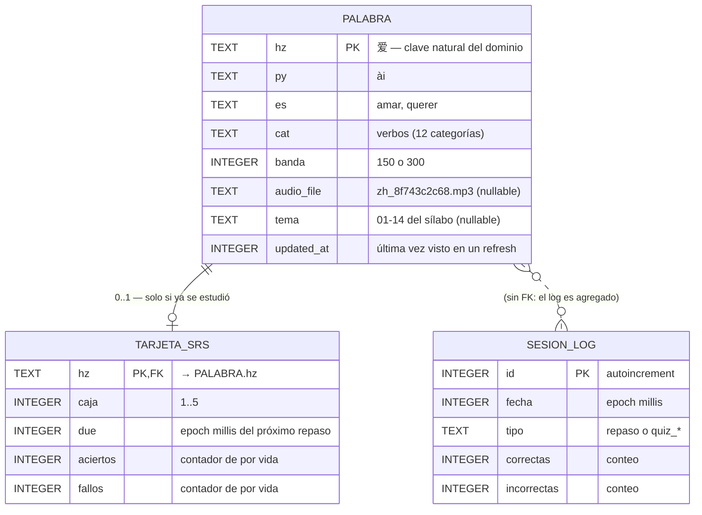

# 04 — Modelo de datos local (Room / SQLite)

> App de práctica de chino · [Volver al índice](INDEX.md)
> Room = la base local del teléfono. Guarda dos cosas de naturaleza distinta:
> **catálogo** (copia del sitio, se refresca) y **progreso** (nace local, es sagrado).

## Diagrama ER



## Decisiones de diseño

**1. `hz` como clave primaria natural (no un id autoincremental).**
El hanzi ya es único en todos los datasets del sitio y es la clave con la que
la web guarda su SRS (`localStorage['hsk1-srs']` = `{hz: {box, due}}`).
Usar la misma clave hace el export/import web↔app un mapeo 1:1 sin tablas de
traducción. Costo asumido: si una palabra cambiara de hanzi (no pasa), sería
delete+insert.

**2. `TARJETA_SRS` separada de `PALABRA` (no columnas extra en palabra).**
El refresh del catálogo hace `UPSERT` sobre `PALABRA`; al estar el progreso en
otra tabla, es **estructuralmente imposible** que un refresh pise tus cajas
(invariante 4 del modelo de dominio). FK con `ON DELETE CASCADE` `[INFERRED]`:
si una palabra sale del catálogo, su tarjeta muere con ella.

**3. `SESION_LOG` es opcional y agregado** — alimenta rachas y un futuro
gráfico de actividad. No guarda respuesta por palabra (eso ya está resumido en
`aciertos/fallos` de la tarjeta). Si en v1 estorba, se omite sin dolor.

**4. Lo que NO va en Room:**
| Dato | Dónde vive | Por qué |
|---|---|---|
| Ajustes (hora de notificación, maxNuevas, modo) | **DataStore** | clave-valor simple, API reactiva |
| MP3 cacheados | **SimpleCache de ExoPlayer** (disco) | gestiona LRU y particiones solo |
| Palabra del día | **se calcula** (`díaDelAño % catálogo`) | derivable, no se persiste |
| `stats.json` del sitio | memoria (o DataStore con TTL) `[INFERRED]` | efímero, chico |

## Consultas que definen los índices

```sql
-- La consulta más frecuente de la app (cola de repaso + notificación):
SELECT * FROM tarjeta_srs WHERE due <= :ahora;          -- índice en (due)

-- Palabras nuevas para completar la sesión:
SELECT p.* FROM palabra p
  LEFT JOIN tarjeta_srs t ON t.hz = p.hz
  WHERE t.hz IS NULL LIMIT :maxNuevas;

-- Búsqueda del vocabulario (pantalla Vocab):
SELECT * FROM palabra WHERE hz LIKE :q OR py LIKE :q OR es LIKE :q;
```

Índices: `tarjeta_srs(due)` es el único no trivial. Con 300-1000 palabras todo
lo demás es instantáneo — **no sobre-indexar**.

## Migraciones
Room versiona el esquema. Regla para la v1: partir con `version = 1` y
`fallbackToDestructiveMigration()` SOLO para el catálogo... no existe tal
granularidad → por eso el progreso se exporta (UC-07) antes de cualquier
actualización de app durante el desarrollo. Al publicar: migraciones reales.
