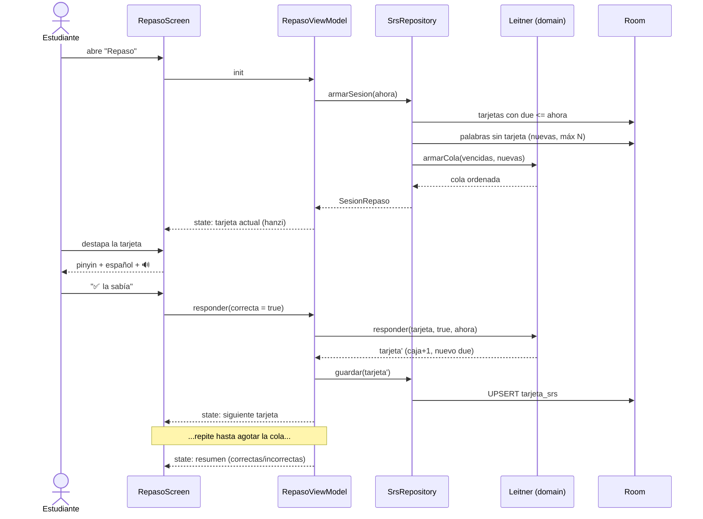
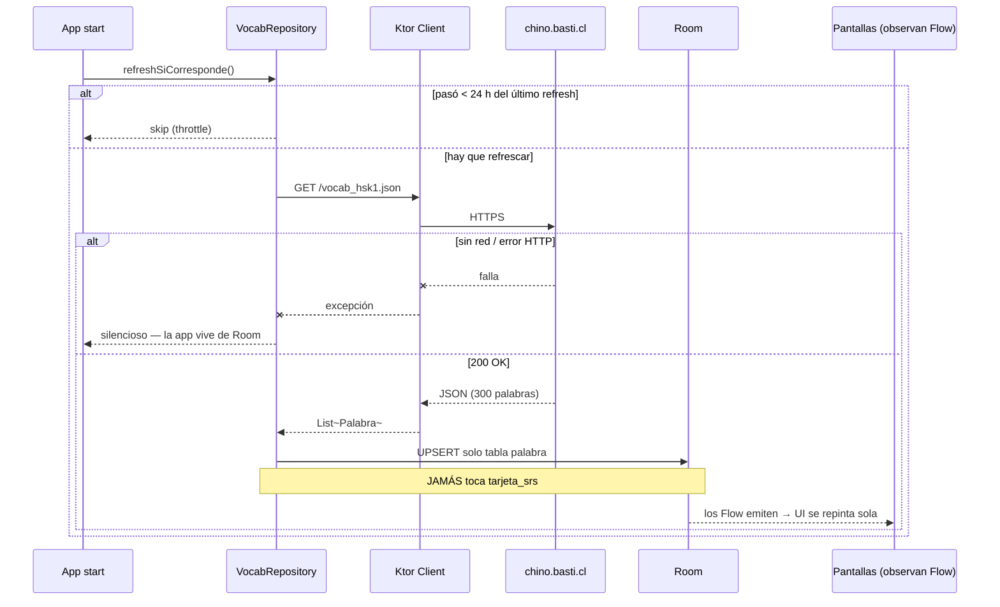
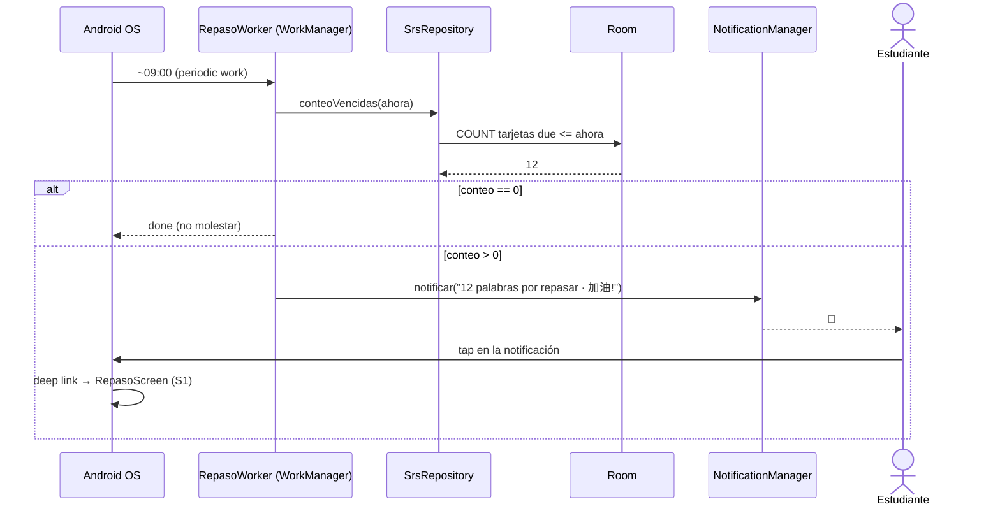
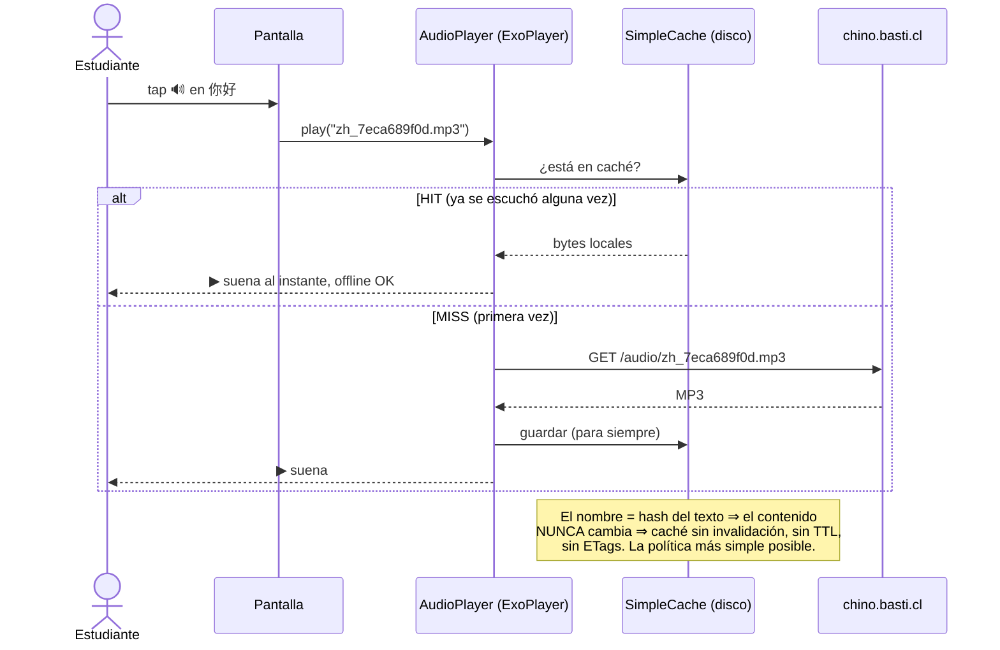

# 05 — Diagramas de secuencia

> App de práctica de chino · [Volver al índice](INDEX.md)
> Los 4 flujos que definen la app. Cada uno cruza las capas de
> [01-arquitectura-c4.md](01-arquitectura-c4.md): UI → ViewModel → Repository → fuentes.

## S1 · Sesión de repaso SRS (UC-01, el flujo estrella)

**Punto didáctico:** la UI nunca decide nada — cada tap se traduce en un evento
al ViewModel, y la pantalla solo pinta el estado que este publica. Si esto queda
claro, Compose + MVVM ya está entendido.

## S2 · Refresh del catálogo al abrir la app (UC-09)

**Punto didáctico:** la UI ni se entera de que hubo red. Observa Room con
`Flow`, y Room "avisa" cuando cambian filas. Offline-first sale de este dibujo.

## S3 · Notificación diaria (UC-06 — sin servidor)

## S4 · Audio con caché (UC-03 — por qué los nombres hasheados son oro)

