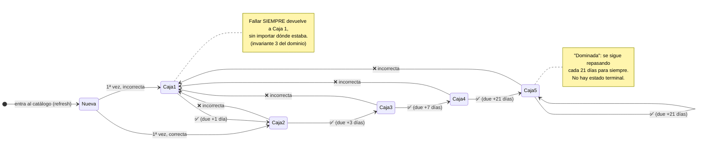
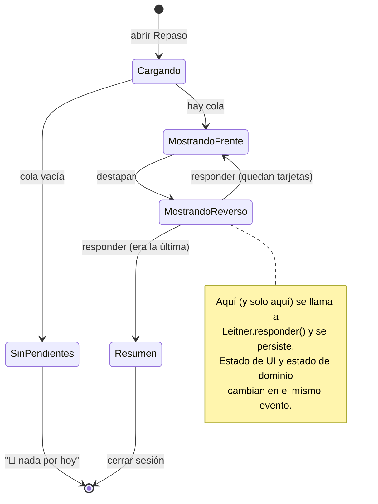

# 06 — Diagrama de estados: la vida de una palabra en el SRS

> App de práctica de chino · [Volver al índice](INDEX.md)
> El ciclo Leitner completo de una palabra, de desconocida a dominada.
> Es la máquina de estados que implementa `domain/Leitner.kt`.

## Ciclo de vida de una palabra

## Estados dentro de una sesión de repaso (RepasoViewModel)

La otra máquina de estados: la de la **pantalla** durante una sesión (S1 de
[05-secuencias.md](05-secuencias.md)).

## Por qué modelar esto como máquinas de estados

1. **Cada `state` es una data class de Kotlin** (`sealed interface RepasoUiState`)
   y Compose pinta por `when` exhaustivo — el compilador te obliga a dibujar
   todas las pantallas posibles. Los diagramas de arriba SON el código.
2. Los tests del dominio se leen directo del primer diagrama:
   `caja5 + incorrecta → caja1`, `nueva + correcta → caja2`, etc. Una fila de
   la tabla de transiciones = un test unitario.
3. Si un estado no está en el diagrama, no existe en la app — no hay "pantalla
   rara" alcanzable por un camino no dibujado.
