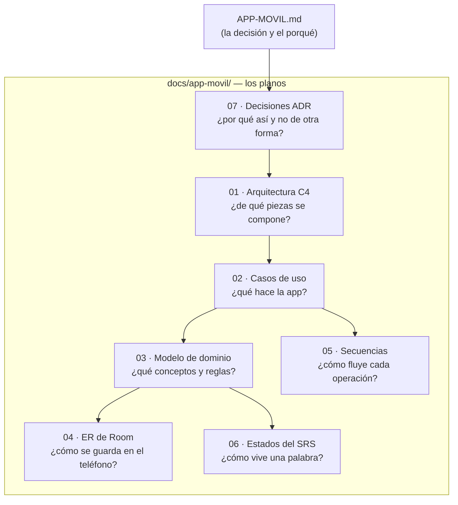

# 📱 App de práctica de chino — Documentación de ingeniería

> Planificación de la app Android (Kotlin + Jetpack Compose) descrita en
> [APP-MOVIL.md](../../APP-MOVIL.md). Estado: **planificada, sin código aún**.
> Todos los diagramas son Mermaid (GitHub los renderiza solo).

## Mapa de la documentación

## Orden de lectura sugerido

| # | Documento | Responde a | Léelo cuando |
|---|---|---|---|
| 0 | [APP-MOVIL.md](../../APP-MOVIL.md) | ¿Por qué esta app y este stack? | Antes que nada |
| 1 | [07-decisiones-adr.md](07-decisiones-adr.md) | Las 7 decisiones y sus descartes | Para recordar/cuestionar el rumbo |
| 2 | [01-arquitectura-c4.md](01-arquitectura-c4.md) | Contexto → contenedores → componentes | Antes de crear el proyecto |
| 3 | [02-casos-de-uso.md](02-casos-de-uso.md) | Los 9 casos de uso (UC-01…UC-09) | Para saber qué construir |
| 4 | [03-modelo-dominio.md](03-modelo-dominio.md) | Clases, reglas Leitner, invariantes | Antes de escribir `domain/` |
| 5 | [04-er-room.md](04-er-room.md) | Tablas, claves, índices, qué NO va en Room | Antes de escribir `data/` |
| 6 | [05-secuencias.md](05-secuencias.md) | Los 4 flujos capa por capa | Al implementar cada feature |
| 7 | [06-estados-srs.md](06-estados-srs.md) | La máquina de estados del SRS y de la UI | Al escribir Leitner y sus tests |

## Cómo se conecta con la ruta de aprendizaje

Cada hito de [APP-MOVIL.md](../../APP-MOVIL.md) usa estos planos:

| Hito | Qué construyes | Planos que usas |
|---|---|---|
| 1. Kotlin + Compose básico | codelabs | — |
| 2. MVP lista de vocabulario + audio | `VocabScreen`, `ChinoApi`, `AudioPlayer` | 01 (componentes) · 05-S2 · 05-S4 |
| 3. Room + SRS | `domain/Leitner.kt`, tablas, `RepasoScreen` | 03 · 04 · 06 · 05-S1 |
| 4. Notificación diaria | `RepasoWorker` | 02-UC06 · 05-S3 |
| 5. Quiz | `QuizScreen` + inyección de fallos al SRS | 02-UC02 · 03 |
| 6. Widget + pulido | Glance, haptics, dark mode | 01 |
| 7. Export/import | `ProgresoExport` (formato compartido con la web) | 03 · ADR-005 |

## Convenciones de estos documentos
- `[INFERRED]` = supuesto razonable no confirmado con Basti.
- `[PENDING]` = decisión pendiente (p. ej. el esquema exacto del export, que se
  congela junto con PLAN-MEJORAS 5.4 del sitio).
- Los 12 diagramas fueron validados con el parser de Mermaid 11 (renderizan en GitHub).
